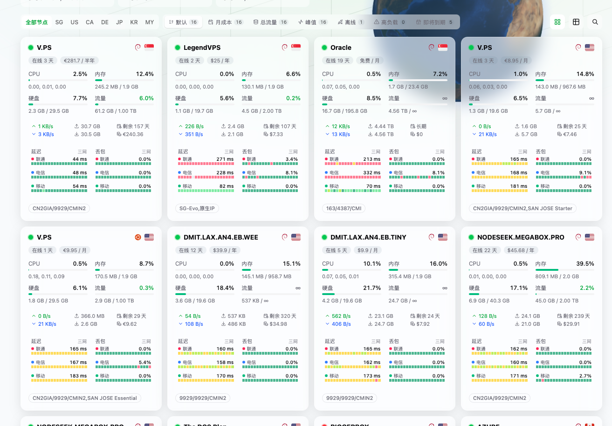

# Komari Glaze 琉璃



Komari 探针的毛玻璃风格主题，内置电信、联通、移动三网延迟与丢包面板。

本项目基于 [vlongx/komari-theme-Glassmorphism-three-network](https://github.com/vlongx/komari-theme-Glassmorphism-three-network) 继续维护，后者转载并二次修改自 [sanrokamlan-prog/komari-theme-Glassmorphism](https://github.com/sanrokamlan-prog/komari-theme-Glassmorphism)。

三网延迟与丢包数据展示来自 vlongx 的修改，其余主要功能、界面设计和代码均来源于原项目。为避免与原版主题在 Komari 中互相覆盖，本主题的 `short` 已改为 `Glaze`。

## 兼容性

本主题以 Komari server 1.4.3 和 agent 1.5.11 为基线开发和验证，其他版本未经验证。

## Ping 任务命名

三网面板根据 Ping 任务名称识别运营商，建议在 Komari 中创建三个 Ping 任务并命名为：

```text
联通
电信
移动
```

也兼容：Unicom/CUCC、Telecom/CTCC/ChinaNet/CN2、Mobile/CMCC/CMI/CMIN2。

## 致谢

感谢原项目作者 **sanrokamlan-prog**、**vlongx** 及所有贡献者的开发、维护与开源分享。

如需查看原版功能、安装方式及最新版本，请访问原项目：

https://github.com/sanrokamlan-prog/komari-theme-Glassmorphism

本项目继续遵循原项目的 MIT License。
